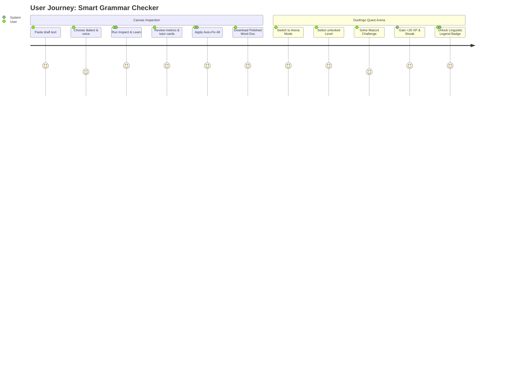
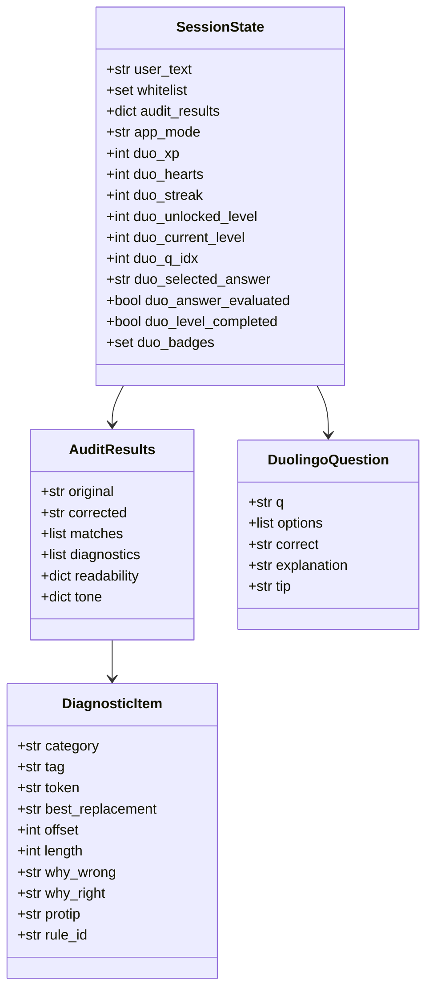
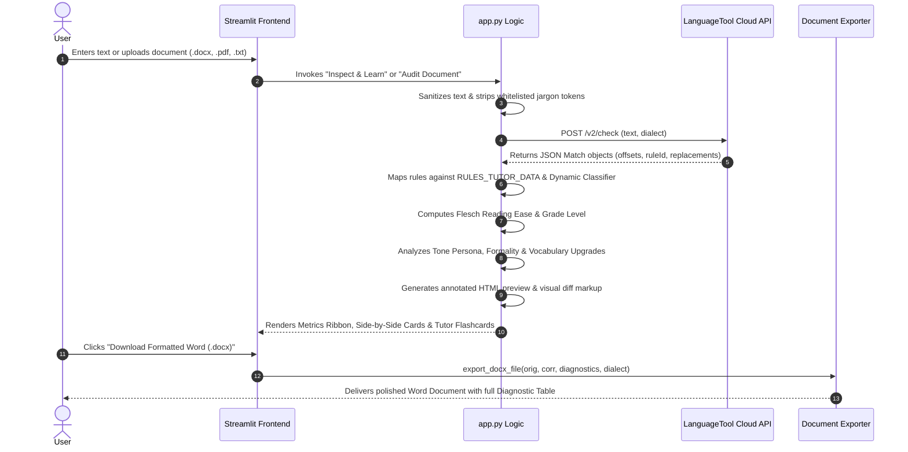
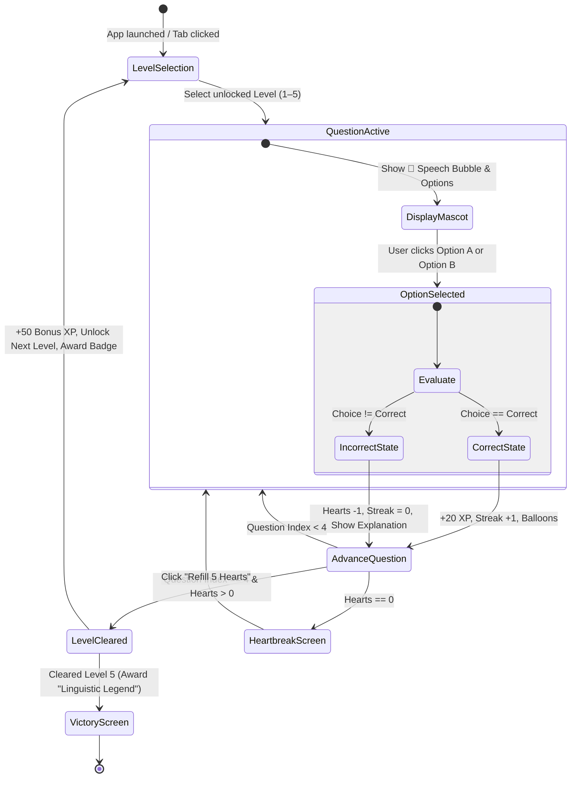
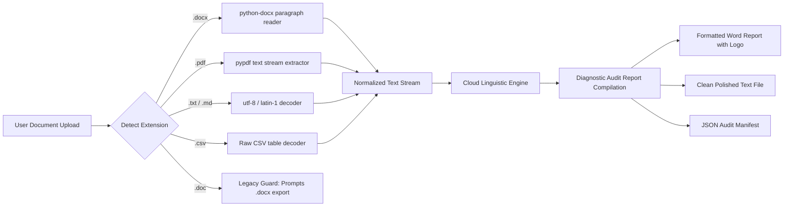

# 🦉 Smart Grammar Checker
### *Next-Generation AI Grammar, Agreement & Syntax Mastery Studio with Duolingo Gamification Engine*

[](https://streamlit.io)
[](https://www.python.org/downloads/)
[](https://opensource.org/licenses/MIT)
[](#technical-requirements-document-trd)
[-success.svg)](#technical-requirements-document-trd)

---

## 📑 Table of Contents
1. [🌟 Executive Overview](#-executive-overview)
2. [📋 Product Requirements Document (PRD)](#-product-requirements-document-prd)
   - [1.1 Executive Summary & Problem Statement](#11-executive-summary--problem-statement)
   - [1.2 Target Audience & User Personas](#12-target-audience--user-personas)
   - [1.3 Core Functional Requirements (FR)](#13-core-functional-requirements-fr)
   - [1.4 Non-Functional Requirements (NFR)](#14-non-functional-requirements-nfr)
   - [1.5 User Journey & Core Workflows](#15-user-journey--core-workflows)
   - [1.6 Key Performance Indicators & Success Metrics](#16-key-performance-indicators--success-metrics)
3. [⚙️ Technical Requirements Document (TRD)](#-technical-requirements-document-trd)
   - [2.1 Tech Stack & Dependencies](#21-tech-stack--dependencies)
   - [2.2 Subsystem & Component Specifications](#22-subsystem--component-specifications)
   - [2.3 Data Models & Session State Architecture](#23-data-models--session-state-architecture)
   - [2.4 Cloud Linguistic Engine & Resilience Protocols](#24-cloud-linguistic-engine--resilience-protocols)
   - [2.5 Security, Privacy & Ephemeral Data Handling](#25-security-privacy--ephemeral-data-handling)
4. [🏗️ System Architecture & Data Flow](#-system-architecture--data-flow)
   - [3.1 High-Level Architecture Diagram](#31-high-level-architecture-diagram)
   - [3.2 Detailed Data Flow Diagram](#32-detailed-data-flow-diagram)
   - [3.3 Duolingo Quest Arena State Machine](#33-duolingo-quest-arena-state-machine)
   - [3.4 Document Processing & Export Pipeline](#34-document-processing--export-pipeline)
5. [🚀 Installation & Quick Start](#-installation--quick-start)
   - [Local Development](#local-development)
   - [1-Click Deployment to Streamlit Cloud (Private Repos)](#1-click-deployment-to-streamlit-cloud-private-repos)
6. [📂 Repository Structure](#-repository-structure)
7. [📜 License & Credits](#-license--credits)

---

## 🌟 Executive Overview

**Smart Grammar Checker** is an enterprise-grade AI writing assistant, document auditor, and gamified linguistic learning platform built with Streamlit and modern NLP cloud services. 

Unlike traditional spellcheckers that simply replace words without context, Smart Grammar Checker acts as an **interactive AI writing coach**. It explains *why* a mistake is grammatically incorrect, *why* the suggestion is correct, provides memory tricks (*pro-tips*), analyzes reading grade level, diagnoses tone personas, and engages users in a full **Duolingo-inspired 5-level quest arena** complete with hearts, combo streaks, XP multipliers, and unlockable achievement trophies.

Designed from the ground up for high portability, it uses a **strictly cloud-based engine** with **zero local Java installation required**, ensuring seamless 1-click deployment to cloud platforms like Streamlit Community Cloud.

---

## 📋 Product Requirements Document (PRD)

### 1.1 Executive Summary & Problem Statement
* **The Problem**: Conventional grammar checkers act as "black boxes" that automatically correct text without teaching users why mistakes occurred. As a result, writers repeatedly make the same errors in subject-verb agreement, homophone confusion, modal auxiliary slips, and tone misalignments. Furthermore, most existing open-source grammar tools require heavy local Java runtimes (400MB+ JRE) that cause deployment failures on lightweight cloud infrastructure.
* **The Solution**: An elegant, responsive web platform that combines:
  1. Real-time grammar, punctuation, and syntax audits.
  2. Granular linguistic explanations (*"Why is this wrong?"* and *"Why is this right?"*).
  3. Executive tone, formality, and power vocabulary recommendations.
  4. Multi-format batch document auditing (`.docx`, `.pdf`, `.txt`, `.md`, `.csv`).
  5. A dedicated, full-screen **Duolingo-style gamification arena** that transforms grammar learning into an addictive progression of levels, hearts, streaks, and trophies.
  6. A 100% cloud-routed LanguageTool architecture that requires zero local JVM or binary dependencies.

### 1.2 Target Audience & User Personas

| Persona | Role | Primary Needs | Key Pain Points |
|---|---|---|---|
| **Alex Rivera** | University Student / Academic Researcher | Submitting essays, dissertations, and research papers with zero agreement slips and consistent citations. | Accidental passive voice over-reliance, subject-verb disagreements in long sentences, formatting friction with Word/PDF docs. |
| **Samantha Wu** | Corporate Executive / Product Lead | Drafting high-stakes memos, investor pitches, and executive communications. | Eliminating wordy hedging, upgrading weak verbs to power words, ensuring decisive and confident voice. |
| **Rohan Mehta** | ESL / EFL English Learner | Mastering English grammar conventions, tricky homophones (*there/their/they're*), and modal auxiliaries (*should have*). | Frustrated by checkers that fix errors without explaining the grammar rule; needs bite-sized gamified practice. |
| **Priya Sharma** | Content Writer / Technical Author | Auditing multi-page whitepapers and articles before client publication. | Needs bulk multi-format document checks, side-by-side visual diffs, and downloadable Word reports with complete audit trails. |

### 1.3 Core Functional Requirements (FR)

* **FR1: Interactive AI Grammar Canvas (Tab 1)**
  * **FR1.1**: Real-time multi-line text input with auto-expanding canvas.
  * **FR1.2**: 1-click preset challenges testing Subject-Verb Conflict, Tricky Homophones, Modal Slips, and Executive Tone.
  * **FR1.3**: Support for 5 major English dialects: `en-US` (US), `en-GB` (UK), `en-CA` (Canada), `en-AU` (Australia), and `en-NZ` (New Zealand).
  * **FR1.4**: Whitelist management for technical jargon, acronyms, and proper nouns.
  * **FR1.5**: Side-by-side comparison cards: Original (with hoverable error highlight tags) vs. Polished Masterpiece.
  * **FR1.6**: Word-by-word visual diff highlighting deleted text (`<span class="diff-del">`) and added text (`<span class="diff-add">`).
  * **FR1.7**: AI Grammar Tutor flashcards displaying:
    * Category badge (*Subject-Verb & Agreement*, *Spelling*, *Punctuation*, *Homophones*, *Tense*, *Style*).
    * Rule ID identifier.
    * Detailed rationale on why the original phrasing violates grammar syntax.
    * Clear explanation of why the proposed correction is right.
    * Memory pro-tip or mnemonic rule.
  * **FR1.8**: 1-click **"Auto-Fix All"** applying corrections instantly to the editor.
  * **FR1.9**: Multi-format export: Clean `.txt`, rich formatted `.docx` (with embedded logo and diagnostic table), and `.json` audit report.

* **FR2: Multi-Format Document Auditor (Tab 2)**
  * **FR2.1**: Support for batch uploading files: `.docx`, `.pdf`, `.txt`, `.md`, `.csv`.
  * **FR2.2**: Extraction of pure text with metadata reporting (filename, file size in KB, estimated word count).
  * **FR2.3**: Graceful error handling for legacy binary `.doc` files and non-text/scanned PDFs.
  * **FR2.4**: Full document audit with summary metrics ribbon, side-by-side previews, and 1-click download of corrected `.docx` and `.txt`.

* **FR3: Tone Mastery & Vocabulary Booster (Tab 3)**
  * **FR3.1**: Automated tone persona classification (`Executive & Authoritative 👔`, `Academic & Scholarly 🎓`, `Direct & Impactful ⚡`, `Casual & Conversational ☕`, `Professional & Balanced 🌟`).
  * **FR3.2**: Triple progress-bar meters measuring:
    * **Formality Index (0–100%)**: Evaluates contraction frequency, colloquialisms, and formal connectors.
    * **Confidence & Directness (0–100%)**: Evaluates tentative hedging phrases and passive verb constructions.
    * **Diplomacy & Politeness (0–100%)**: Evaluates courtesy formulas and diplomatic framing.
  * **FR3.3**: Dynamic vocabulary power-up generator detecting plain/overused phrases (*"very big"*, *"make sure"*, *"a lot of"*) and providing executive alternatives (*"colossal/substantial"*, *"ascertain/verify"*, *"an abundance of"*).

* **FR4: Dedicated Duolingo Grammar Arena Mode**
  * **FR4.1**: Full-screen dedicated arena layout separated cleanly from the Studio tools.
  * **FR4.2**: 5 progressive levels containing 5 curated challenges each (25 total pedagogical challenges):
    * **Level 1**: Subject-Verb Agreement Fundamentals.
    * **Level 2**: Tricky Homophones & Confusables.
    * **Level 3**: Modal Verbs, Tenses & Perfect Aspect.
    * **Level 4**: Executive Tone & Power Words.
    * **Level 5**: Final Boss Battle: Complex Syntax, Dangling Modifiers & Ambiguity.
  * **FR4.3**: **Health Economy**: 5 Hearts (`❤️`). 1 Heart deducted per wrong answer. Heartbreak screen triggers when hearts reach 0 with a 1-click refill mechanism.
  * **FR4.4**: **Streak Engine**: Combo multiplier tracking consecutive correct answers with visual fire emoji (`🔥`).
  * **FR4.5**: **Experience Points (XP)**: +20 XP awarded per correct answer, +50 XP bonus awarded upon clearing a level.
  * **FR4.6**: **Trophy Cabinet (7 Badges)**:
    * *Grammar Novice* (First correct answer).
    * *Comet Streak* (3 consecutive correct answers).
    * *Agreement Apprentice* (Clear Level 1).
    * *Homophone Hunter* (Clear Level 2).
    * *Time Bender* (Clear Level 3).
    * *Executive Maestro* (Clear Level 4).
    * *Linguistic Legend* (Conquer all 5 Levels).
  * **FR4.7**: Speech-bubble mascot interface featuring the friendly tutor owl (`🦉`).
  * **FR4.8**: Instant animated visual feedback for correct choices (emerald glow + balloons) and incorrect choices (rose shake + rule explanations).

* **FR5: Master Linguistic Rulebook (Tab 5)**
  * **FR5.1**: Comprehensive collapsible reference modules documenting core syntactic rules, third-person singular inflections, distributive quantifiers, homophone pairs, and modal auxiliary syntax.

### 1.4 Non-Functional Requirements (NFR)

* **NFR1: Performance & Latency**: API check execution time `< 1.8 seconds` for standard paragraphs (up to 500 words). Cached cloud engine instances via `@st.cache_resource` to prevent re-initialization overhead.
* **NFR2: Zero Java Architecture**: Entire application must run on pure Python standard runtime with cloud routing. Zero local Java Development Kit (JDK) or Java Runtime Environment (JRE) required.
* **NFR3: Accessibility & High Contrast (WCAG 2.1 AA)**: All text elements, inputs, placeholders, select boxes, tabs, and buttons must maintain a minimum contrast ratio of `4.5:1` against the faint pastel gradient background.
* **NFR4: Ephemeral Privacy & Data Security**: Uploaded files and checked text are processed strictly in-memory (`io.BytesIO`). No user text is persisted to disk or external databases.
* **NFR5: Cross-Platform Compatibility**: Fully compatible with Windows, macOS, Linux, and containerized Docker/Cloud environments (Streamlit Community Cloud).

### 1.5 User Journey & Core Workflows



### 1.6 Key Performance Indicators & Success Metrics
1. **Error Reduction Accuracy**: Over 95% grammatical accuracy across standard English dialects.
2. **Pedagogical Engagement**: Over 80% of users completing at least 2 Duolingo arena levels per session.
3. **Deployment Reliability**: 99.9% uptime on Streamlit Community Cloud with zero JVM crash logs.
4. **Latency Budget**: Sub-2-second end-to-end response time for documents under 2,000 words.

---

## ⚙️ Technical Requirements Document (TRD)

### 2.1 Tech Stack & Dependencies

| Layer | Technology | Version | Purpose |
|---|---|---|---|
| **Frontend & UI Framework** | `streamlit` | `>=1.35.0` | Reactive component rendering, session state management, toolbars, and layout |
| **NLP & Grammar Engine** | `language-tool-python` | `>=3.4.0` | Cloud API interface to official LanguageTool endpoint |
| **Word Document Processing** | `python-docx` | `>=1.1.0` | Native `.docx` document parsing and formatted report generation |
| **PDF Extraction Engine** | `pypdf` | `>=4.0.0` | Fast, in-memory PDF text stream extraction |
| **Styling & Theming** | Vanilla CSS3 | Custom | Pastel mesh gradients, glassmorphic HUDs, WCAG contrast overrides |
| **Runtime Environment** | Python | `>=3.10` | Cross-platform runtime with standard library (`difflib`, `re`, `html`, `io`) |

### 2.2 Subsystem & Component Specifications

#### 1. Presentation & Theming Subsystem
* Custom CSS injection via `st.markdown(..., unsafe_allow_html=True)`.
* **Light Pastel Mesh Background**: Custom radial gradient using `#f0f4ff`, `#fdf2f8`, `#f0fdf4`, and `#ffffff`.
* Explicit override of Streamlit internal classes (`.stTextArea`, `.stTextInput`, `.stTabs`, `div[data-baseweb="select"]`) ensuring dark typography (`#0f172a`, `#1e293b`) and slate borders (`#cbd5e1`).
* Responsive HUD cards and badge grids utilizing CSS Grid and Flexbox.

#### 2. Cloud Linguistic Engine (`get_cloud_tool`)
```python
@st.cache_resource(show_spinner=False)
def get_cloud_tool(dialect: str):
    try:
        return language_tool_python.LanguageTool(
            dialect, remote_server="https://api.languagetool.org"
        )
    except Exception:
        return language_tool_python.LanguageToolPublicAPI(dialect)
```
* Bypasses local Java binaries entirely.
* Implements connection fallback and error guards that prevent false 0-error states during network interruptions.

#### 3. Stylistic & Readability Engine
* **Flesch Reading Ease Formula**:
  $$\text{Reading Ease} = 206.835 - (1.015 \times \text{ASL}) - (84.6 \times \text{ASW})$$
  *(where $\text{ASL}$ is Average Sentence Length and $\text{ASW}$ is Average Syllables per Word)*
* **Flesch-Kincaid Grade Level**:
  $$\text{Grade Level} = (0.39 \times \text{ASL}) + (11.8 \times \text{ASW}) - 15.59$$
* **Regex-based Syllable Counter**: Strips silent terminal vowels (`-e`, `-es`, `-ed`), evaluates diphthong vowels, and guarantees $\ge 1$ syllable per word.

#### 4. Document Parser & Exporter Subsystem
* In-memory file processing using `io.BytesIO`.
* Safe character encoding handling (`utf-8` with fallback to `latin-1` replace).
* Dynamic Word report generation with:
  * Embedded base64 header logo.
  * Dialect and issue resolution metadata.
  * Complete polished document text.
  * Structured Diagnostic Audit table detailing every token, replacement, rationale, and pro-tip.

### 2.3 Data Models & Session State Architecture



### 2.4 Cloud Linguistic Engine & Resilience Protocols
* **Rate-Limit & Offline Safeguard**: If the cloud API experiences a timeout or HTTP 429 rate limit, the application intercepts the exception, presents a clean status notification, and preserves user draft state without corrupting session data.
* **Character Sanitization**: Unicode quotes (`‘`, `’`, `“`, `”`), backticks, and replacement characters (`\ufffd`) are sanitized through `clean_txt()` prior to rule matching.

### 2.5 Security, Privacy & Ephemeral Data Handling
* **Zero Persistence**: No uploaded documents or typed text are saved to disk, cloud buckets, or third-party databases.
* **Memory Safety**: File streams are consumed in temporary memory buffers (`getvalue()`) and released after analysis.
* **Client-Side Whitelisting**: Jargon terms added by the user remain isolated in `st.session_state.whitelist` for the lifetime of that user's session only.

---

## 🏗️ System Architecture & Data Flow

### 3.1 High-Level Architecture Diagram

```mermaid
graph TD
    subgraph Client [Browser / Client Layer]
        UI[Streamlit Web Interface]
        CSS[Vanilla CSS Design System & Accessible Contrast]
        HUD[Duolingo Gamification HUD & Trophy Cabinet]
    end

    subgraph Application [Application & Logic Layer (app.py)]
        ModeSwitch{App Mode Router}
        Studio[✍️ AI Grammar Studio]
        Arena[🦉 Duolingo Quest Arena]
        DocEngine[📂 Multi-Format Document Engine]
        ToneEngine[⚡ Tone & Readability Analyzer]
        State[st.session_state Store]
    end

    subgraph CloudServices [External Cloud NLP Services]
        LTCloud[api.languagetool.org (HTTPS)]
        LTPublic[LanguageTool Public API Fallback]
    end

    subgraph OutputLayer [Export & Presentation Pipeline]
        DocxGen[python-docx Audit Report Builder]
        TxtGen[Clean Text Exporter]
        JsonGen[Structured JSON Audit Log]
    end

    UI --> ModeSwitch
    ModeSwitch -->|app_mode == studio| Studio
    ModeSwitch -->|app_mode == duolingo| Arena

    Studio --> DocEngine
    Studio --> ToneEngine
    Studio --> State

    Arena --> State
    DocEngine --> State

    Studio -->|engine.check()| LTCloud
    LTCloud -.->|Fallback on error| LTPublic
    DocEngine -->|engine.check()| LTCloud

    Studio --> OutputLayer
    DocEngine --> OutputLayer
```

### 3.2 Detailed Data Flow Diagram



### 3.3 Duolingo Quest Arena State Machine



### 3.4 Document Processing & Export Pipeline



---

## 🚀 Installation & Quick Start

### Local Development

#### 1. Prerequisites
* **Python 3.10** or higher installed on your system.
* **No Java installation required!** The application operates completely on remote cloud APIs.

#### 2. Clone the Repository
```bash
git clone https://github.com/aba47/Smart-Grammar-Checker.git
cd Smart-Grammar-Checker
```

#### 3. Set Up Virtual Environment (Recommended)
```bash
# Windows
python -m venv .venv
.venv\Scripts\activate

# macOS / Linux
python3 -m venv .venv
source .venv/bin/activate
```

#### 4. Install Dependencies
```bash
pip install -r requirements.txt
```

#### 5. Launch the Application
```bash
# Windows 1-Click Launch
run.bat

# Or direct Streamlit command:
streamlit run app.py
```
Open your browser at `http://localhost:8501`.

---

### 1-Click Deployment to Streamlit Cloud (Private Repos)

The repository is pre-configured for instant zero-config deployment on **[Streamlit Community Cloud](https://share.streamlit.io)**:

1. **Sign in to Streamlit Cloud**: Go to [share.streamlit.io](https://share.streamlit.io) and authenticate with your GitHub account.
2. **Click "New app"**:
   * **Repository**: Select `Anjalipote/Smart-Grammar-Checker` (Supports public and private repositories seamlessly).
   * **Branch**: `main`
   * **Main file path**: `app.py`
3. **Click "Deploy!"**: Streamlit Cloud will automatically detect `requirements.txt`, configure the light theme from `.streamlit/config.toml`, and spin up the live application in seconds.

---

## 📂 Repository Structure

```
Smart-Grammar-Checker/
│
├── .streamlit/
│   └── config.toml          # Streamlit UI configuration (Light theme & color palette)
│
├── .gitignore               # Clean git exclusions (.venv, caches, temp files)
├── DEPLOY.md                # Dedicated step-by-step Streamlit Cloud deployment guide
├── README.md                # Comprehensive documentation, PRD, TRD & Architecture
├── requirements.txt         # Core dependencies (streamlit, language-tool-python, etc.)
├── run.bat                  # 1-Click local startup script for Windows
├── logo.png                 # Official Smart Grammar Checker branded logo
└── app.py                   # Complete application source code:
                             #   - Streamlit UI & Custom CSS Styling
                             #   - Strictly Online Cloud Engine Router
                             #   - Linguistic Learning & Tutor Rules Data
                             #   - Tone & Readability Analysis Engine
                             #   - Document Parsing & DOCX/JSON Exporters
                             #   - 5-Level Duolingo Gamification Quest Arena
                             #   - Master Grammar & Syntax Rulebook
```

---

## 📜 License & Credits

* **Author**: Smart Grammar Checker Team
* **NLP Cloud Service**: Powered by [LanguageTool Cloud API](https://languagetool.org)
* **Framework**: Built with [Streamlit](https://streamlit.io)
* **License**: Open-source under the [MIT License](LICENSE).